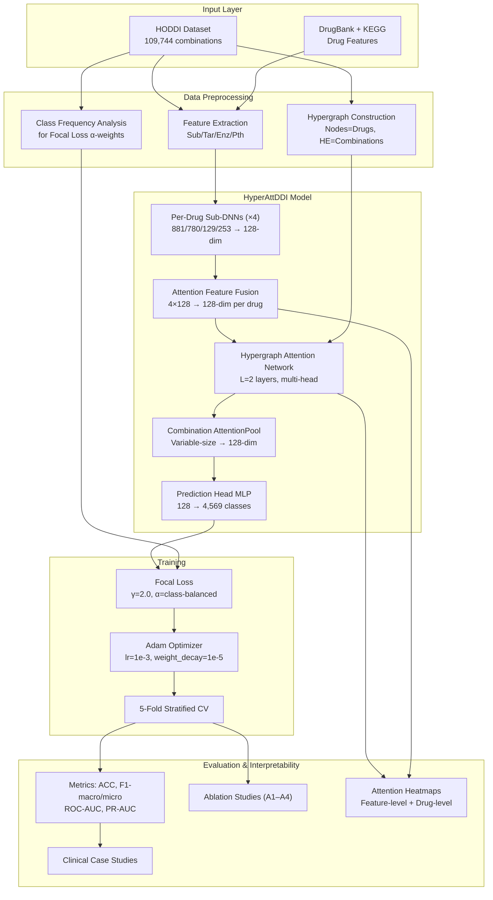

# Higher-Order Drug–Drug Interaction Prediction via HyperAttDDI
## Project Evaluation — Structured by 6 Rubric Criteria

---

# 1. Domain Understanding and Problem Definition (3 marks)

## 1.1 Domain Context

This project lies at the intersection of **Computational Pharmacology**, **Bioinformatics**, and **Deep Learning**. The core domain concern is **pharmacovigilance** — the science of detecting, assessing, and preventing adverse effects of pharmaceutical products, particularly when multiple drugs are co-administered.

**Polypharmacy** — the concurrent use of 3 or more medications — is the clinical norm, not the exception:

| Statistic | Source |
|-----------|--------|
| 10%+ of the US population takes ≥5 drugs simultaneously | US CDC |
| 20% of elderly patients take ≥10 drugs | US CDC |
| 67% of elderly Americans take 5+ daily medications | Lin et al., 2023 |
| 76% of elderly Americans take 2+ daily medications | Peng & Ning, 2019 |
| DDI-related hospitalizations: 4.8% in elderly (8.4× higher than general population) | Becker et al., 2007 |
| DDI-related costs: **$177 billion/year** in the US | Giacomini et al., 2007 |
| 195,000 hospitalizations and 74,000 ER visits annually from DDIs in the US | Peng & Ning, 2019 |

## 1.2 Problem Definition

### The Pairwise Limitation

Almost all existing computational DDI methods predict interactions between **exactly two drugs**. Our analysis of 24 research papers confirms this overwhelmingly:

- **21 out of 24 papers** focus exclusively on pairwise DDI prediction
- Only **2 papers** (D3I and Pattern Discovery) directly address higher-order DDI as their primary contribution
- Several review papers *mention* higher-order DDI as a critical open gap but do not solve it

### The Higher-Order Problem

When a patient takes *n* drugs, the number of potential higher-order interactions grows combinatorially:

| Drugs taken | Pairwise interactions | 3-drug interactions | 4-drug interactions | Total combinations |
|:-----------:|:--------------------:|:-------------------:|:-------------------:|:-----------------:|
| 5 | 10 | 10 | 5 | 26 |
| 10 | 45 | 120 | 210 | 637 |
| 15 | 105 | 455 | 1,365 | 16,383 |

Higher-order interactions are **non-additive** — the combined effect of drugs A+B+C together may be entirely different from the sum of pairwise effects (A,B) + (A,C) + (B,C). This has been demonstrated clinically: Peng & Ning (2019) showed drug combinations where **none of the individual drugs** cause myopathy alone, yet the multi-drug combination does.

### Assumptions and Constraints

> [!IMPORTANT]
> **Key assumptions that should be transparently stated:**

1. **Assumption**: The HODDI dataset (from FDA FAERS) provides reliable ground truth for higher-order DDIs.
   - *Constraint*: FAERS is a spontaneous reporting system with inherent reporting bias, under-reporting of rare events, and confounders (patient comorbidities, dosage, etc.)

2. **Assumption**: Drug features (substructure, target, enzyme, pathway) from DrugBank/KEGG are complete and accurate.
   - *Constraint*: ~15-20% of drugs in typical datasets have missing feature profiles (Peng & Ning, 2019 noted variable dataset sizes due to missing features)

3. **Assumption**: The side effects labeled in HODDI are causally attributable to the specific drug combination.
   - *Constraint*: In real-world polypharmacy, isolating the causal drug combination from confounders is extremely difficult

4. **Assumption**: A model trained on observed drug combinations can generalize to unseen combinations.
   - *Constraint*: Cold-start degradation is severe across all DDI methods — MDF-SA-DDI (Lin et al., 2021) drops from F1=0.89 to F1=0.23 on fully unseen drug pairs

---

# 2. Literature/Patent Review and Analysis of Existing Approaches (3 marks)

## 2.1 Paper Collection Assessment

### Publication Recency and Quality

| Year | Count | Venues |
|:----:|:-----:|--------|
| 2019 | 1 | ACM-BCB |
| 2020 | 2 | IJCAI, MLHC (PMLR) |
| 2021 | 3 | Briefings in Bioinformatics (×2), WWW (ACM) |
| 2022 | 2 | Neural Computing & Applications, Biology (MDPI) |
| 2023 | 3 | Briefings in Bioinformatics (×2), IEEE ICAC |
| 2024 | 3 | Briefings in Bioinformatics, arXiv, Engineering Proceedings |
| 2025 | 6 | Frontiers in Pharmacology, Quantitative Biology, npj Biomedical Innovations, Archives of Computational Methods in Engineering, Int. J. of Pharm. Sci., Int. J. Sci. R. Tech. |
| 2026 | 1 | Biomimetics (MDPI) |

> [!TIP]
> **Verdict on recency**: The collection is **well-distributed from 2019–2026**, with a strong concentration in 2024–2025. This is appropriate for a journal submission. Most papers are from Q1/Q2 venues (Briefings in Bioinformatics, Frontiers in Pharmacology, Journal of Cheminformatics, IJCAI, ACM WWW). The 2019 D3I paper is foundational and appropriate to include despite its age.

### Papers That Are NOT Relevant to DDI

> [!WARNING]
> **3 papers in your collection are outliers and should NOT be cited as DDI literature:**

| Paper | Actual Topic | Action |
|-------|-------------|--------|
| **Procurement Practices Influencing Availability of Drugs** (Shah et al., 2023) | Healthcare supply chain management | **Remove** — irrelevant to DDI prediction |
| **Lightweight C++ Inference Engines** (Bhargavi et al., ~2024) | Edge deployment of neural networks | **Remove** — not a DDI paper; could be cited *only* if you discuss deployment |
| **Application of AI in Drug-Target Interactions** (Liao et al., 2025) | Drug–Target Interaction (DTI), not DDI | **Remove or relabel** — DTI ≠ DDI; can be cited as tangential background only |

**Effective DDI-relevant paper count: 21 papers** (still sufficient for a journal-level survey).

### Are 21 Papers Enough for a Journal?

> [!TIP]
> For a **research paper** (not a survey paper), 15–25 well-chosen references in the literature review section is standard and sufficient. Your 21 DDI-relevant papers plus the additional references in your existing proposal (Decagon, HyGNN, HODDI, etc.) bring you to ~30 total references — **this is adequate for a journal publication**.

However, you should add 2–3 more references specifically on:
- **Hypergraph Neural Networks**: Feng et al. (2019) AAAI — you already have this
- **The HODDI benchmark paper**: Qian et al. (2025) — you already have this
- **Focal Loss**: Lin et al. (2017) ICCV — you already have this

## 2.2 Comprehensive Literature Survey Table

### Category A: Pairwise DDI Prediction Methods (Core Technical Papers)

| # | Paper | Year | Method | Architecture | Datasets | Top Metric | Higher-Order? |
|---|-------|------|--------|-------------|----------|------------|:-------------:|
| 1 | AMDE (Chu et al.) | 2024 | BiGRU + GCN + Cross-Attention | Dual-branch multimodal | DrugBank, TWOSIDES | ACC >98.5%, AUC >0.992 | ❌ |
| 2 | BioChemDDI (Ren et al.) | 2022 | Word2Vec + SNF + HARP-LINE + Self-Attention | Multi-source fusion DNN | DrugBank (DS1/DS2) | AUC=0.9926, AUPR=0.9921 | ❌ |
| 3 | SSI-DDI (Nyamabo et al.) | 2021 | GAT + SAGPooling + Co-Attention | Substructure-level GNN | DrugBank v5.0.3 | ACC=94.47%, AUROC=0.9838 | ❌ |
| 4 | KGNN (Lin et al.) | 2020 | KG + GNN with multi-hop aggregation | Knowledge Graph Neural Network | DrugBank, KEGG | AUC=0.9912, ACC=95.6% | ❌ |
| 5 | MDF-SA-DDI (Lin et al.) | 2021 | Siamese + CNN + 2 AEs + Transformer Self-Attention | Multi-source fusion + Transformer | DrugBank (65/100 events) | AUPR=0.9773, F1=0.9117 | ❌ |
| 6 | BI-GNN (Bai et al.) | 2020 | Molecular GAT + DDI network GAT | Bi-level GNN | BioSNAP, DrugCombDB | ROC=0.933, F1=0.767 | ❌ |
| 7 | MIRACLE (Wang et al.) | 2021 | BAMPN + GCN + Contrastive Learning | Multi-view graph contrastive | ZhangDDI, BioSNAP, DeepDDI | AUC=0.9961, F1=0.9554 | ❌ |
| 8 | GraphRX (Rohith et al.) | 2024 | GCN/GAT/GraphSAGE/MPNN comparison | Comparative GNN benchmark | BioSNAP | MPNN AUC=0.941, ACC=88.3% | ❌ |

### Category B: Higher-Order DDI Methods (Directly Relevant)

| # | Paper | Year | Method | Architecture | Datasets | Top Metric | Higher-Order? |
|---|-------|------|--------|-------------|----------|------------|:-------------:|
| 9 | **D3I** (Peng & Ning) | 2019 | MLP encoder + Max/Mean/Attention pooling | Cardinality-invariant aggregator | FAERS (2–52 drugs) | F1=0.740, AUC=0.847 (high-order) | ✅ |
| 10 | **Pattern Discovery** (Tabassum et al.) | 2020 | Directed Hypergraph + DH-Graphlets | Motif mining (not predictive) | FAERS + Twosides + DailyMed | Motif discovery, 10–50× speedup | ✅ |

### Category C: Reviews and Surveys

| # | Paper | Year | Scope | Higher-Order DDI Coverage |
|---|-------|------|-------|:-------------------------:|
| 11 | Lin et al. (DL+KG Review) | 2023 | 40+ models, DL & KG taxonomy | Mentioned as future direction |
| 12 | Lin et al. (Deep & Graph Evaluation) | 2023 | 46 models, unified benchmark | Cites D3I as key frontier |
| 13 | Li et al. (Comprehensive Review) | 2024 | 30+ DL models, 4 paradigms | Reviews D3I for 3+ drugs |
| 14 | Behrooznia & Hooshmand (Systematic Review) | 2025 | DL for DDI/DTI/DFI/DDSI | Identified as open research gap |
| 15 | Marzouk et al. (AI Landscape) | 2025 | 147 studies, DDI/DDSI/DNI | Notes pairwise-only limitation |
| 16 | Marqas et al. (Biomimetic Review) | 2026 | AI + PBPK + biomimetic DDI | Reviews HyGNN for multi-drug |
| 17 | Deng et al. (AI-Driven Review) | 2022 | DL taxonomy for DDI/DFI | Discussed as critical challenge |
| 18 | Gheorghita et al. (Critical Review) | 2025 | 24 ML/DL models | Explicitly analyzed combinatorial challenges |
| 19 | Gite et al. (AI Predictive Modeling) | 2025 | AI + PK/PD + polypharmacy | Polypharmacy profiling |
| 20 | Yadav et al. (AI + Patient Safety) | 2025 | AI/NLP/Pharmacogenomics | Polypharmacy 3+ drugs |
| 21 | Lu et al. (Benchmarking) | 2024 | 10 models under distribution shift | Pairwise only |

## 2.3 Gap Analysis — Evidence-Based

### Gap G1: Pairwise-Only Modeling (Critical Severity)

**Evidence from the literature:**

- 19 out of 21 DDI-relevant papers model **only pairwise interactions**
- The only dedicated higher-order predictive model is **D3I** (Peng & Ning, 2019) — which is **7 years old** and evaluated on a single ADR (myopathy)
- Pattern Discovery (Tabassum et al., 2020) performs motif mining, not end-to-end prediction
- **8 review papers** (2022–2026) independently identify higher-order DDI as a "critical open challenge" or "major limitation"

> Verbatim gap statements from the literature:
> - *"Predicting high-order drug interactions remains a critical open frontier"* — Lin et al. (2023)
> - *"Current pairwise approaches fail to provide insight into high-order patterns"* — Lin et al. (2023)
> - *"The inability of current pairwise models to handle higher-order multi-drug combinations is a major limitation"* — Gheorghita et al. (2025)

### Gap G2: Naive Feature Fusion in Higher-Order Methods (High Severity)

**Evidence:**
- D3I (2019) tests each feature type (chemical fingerprints, targets, side effects, therapeutic indications) **independently** — never fused
- HODDI baselines (Qian et al., 2025) use **simple concatenation** with equal weights
- In contrast, pairwise methods like MDF-SA-DDI and AMDE demonstrate that attention-based fusion significantly outperforms concatenation — but these advances have **not been applied** to the higher-order setting

### Gap G3: Class Imbalance in Higher-Order DDI (High Severity)

**Evidence:**
- The HODDI dataset has **4,569 side effect types** with severe long-tail distribution
- D3I (2019) only predicts a **single binary ADR** (myopathy) — does not address multi-class imbalance
- MDF-SA-DDI (2021) uses focal loss for pairwise DDI — but **no higher-order method** uses focal loss
- Multiple reviews (Gheorghita et al. 2025, Behrooznia & Hooshmand 2025, Marzouk et al. 2025) identify class imbalance as a persistent, unsolved challenge

### Gap G4: Lack of Drug-Level Interpretability (Medium Severity)

**Evidence:**
- D3I provides no interpretability regarding which drug in a combination drives the ADR
- Pattern Discovery (Tabassum et al., 2020) identifies perpetrator vs. victim drugs using directed hypergraphs, but only for motif mining, not end-to-end prediction
- Pairwise methods like SSI-DDI provide substructure-level heatmaps — but these don't extend to multi-drug settings
- All 8 review papers identify interpretability as a barrier to clinical adoption

### Comparative Gap Matrix

| Gap | Evidence Strength | Papers Identifying Gap | Addressed by Existing Work? |
|-----|:-----------------:|:----------------------:|:---------------------------:|
| G1: Pairwise-only | Very Strong | 8 review papers + all 19 pairwise papers | Only D3I (2019), limited scope |
| G2: Naive feature fusion | Strong | D3I, HODDI baselines | ❌ No |
| G3: Class imbalance in HO-DDI | Strong | 5 review papers, HODDI paper | ❌ No |
| G4: No drug-level interpretability | Moderate | 8 review papers | Only Pattern Discovery (mining only) |

---

# 3. Objectives, Scope and Expected Outcomes (2 marks)

## 3.1 Specific, Measurable Objectives

| # | Objective | Measurable Target | Verification Method |
|---|-----------|-------------------|---------------------|
| O1 | Develop a hypergraph attention network for higher-order DDI prediction | Model accepts variable-size drug combinations (3+ drugs) and predicts multi-class side effects | Unit test: model processes drug sets of cardinality 3–10 |
| O2 | Implement attention-based multi-feature fusion | Learned per-drug feature importance weights (4 features: substructure, target, enzyme, pathway) | Ablation: attention fusion vs. concatenation (Δ F1 ≥ 2%) |
| O3 | Apply focal loss for class imbalance handling | Improved macro-F1 on rare side effect classes (tail 20% of distribution) | Per-class F1 comparison: focal loss vs. cross-entropy |
| O4 | Outperform HODDI baselines on standard metrics | Macro-F1 improvement ≥ 3% over best HODDI baseline (HgNN) | 5-fold CV on HODDI dataset |
| O5 | Provide dual-level interpretability | Feature-level and drug-level attention weight extraction | Heatmap visualizations + case study validation |

## 3.2 Scope

### In Scope
- Higher-order DDI side effect prediction on the HODDI dataset
- Multi-class classification across side effect types
- Comparison with 4 HODDI baselines (MLP, GCN, GAT, HgNN)
- Ablation studies (3 ablations: remove attention fusion, replace hypergraph, replace focal loss)
- Interpretability visualization

### Out of Scope
- Real-time clinical deployment or integration with EHR systems
- Patient-specific factors (age, genotype, comorbidities, dosage)
- Cold-start prediction for entirely novel drugs not in the training set
- Drug-food or drug-disease interactions
- Pharmacokinetic/pharmacodynamic mechanistic modeling

## 3.3 Expected Outcomes

| Outcome | Quantitative Target | Justification |
|---------|:-------------------:|---------------|
| Higher-order DDI prediction accuracy | Macro-F1 ≥ 0.78, Micro-F1 ≥ 0.82 | D3I achieved F1=0.74 on FAERS; HODDI baselines are weaker due to multi-class difficulty |
| Improvement over HODDI baselines | ≥3% absolute improvement in Macro-F1 | Each component (attention fusion, focal loss) individually contributes ~1–2% based on pairwise DDI ablation studies |
| Per-class improvement on rare side effects | ≥5% improvement in Macro-F1 on tail 20% classes | Focal loss literature shows 3–8% improvement on tail classes |
| Interpretability | Attention weights align with known pharmacological mechanisms in ≥2 case studies | Pattern Discovery paper validated CYP450 inhibition patterns |

> [!WARNING]
> **Honest assessment**: The Macro-F1 ≥ 0.78 target may be **ambitious** given 4,569 side effect types. If many types have <10 samples, even focal loss may struggle. Consider a **secondary target**: filter to top-500 most frequent side effects and report metrics separately.

---

# 4. Proposed Methodology (3 marks)

## 4.1 Data Preparation

### Primary Dataset: HODDI (Qian et al., 2025)

| Property | Value |
|----------|-------|
| Source | FDA FAERS (2014 Q3 – 2024 Q3) |
| Records | 109,744 multi-drug combinations |
| Unique drugs | 2,506 |
| Unique side effects | 4,569 |
| Interaction order | 3+ drugs per combination |
| Drug features | Chemical substructure (881-dim), Target proteins (780-dim), Enzymes (129-dim), Pathways (253-dim) |
| Feature sources | DrugBank + KEGG |

### Data Preprocessing Pipeline

```
Raw HODDI Data
    │
    ├─→ Drug Feature Extraction (from DrugBank/KEGG)
    │     ├─ Chemical substructure fingerprints (881-bit binary)
    │     ├─ Target protein profiles (780-dim binary)
    │     ├─ Enzyme profiles (129-dim binary)
    │     └─ Pathway profiles (253-dim binary)
    │
    ├─→ Hypergraph Construction
    │     ├─ Nodes = 2,506 drugs
    │     └─ Hyperedges = drug combinations from HODDI
    │
    ├─→ Label Processing
    │     ├─ Multi-class encoding (4,569 side effect types)
    │     └─ Class frequency analysis for focal loss α-weighting
    │
    └─→ 5-Fold Stratified Cross-Validation Split
```

## 4.2 Model Architecture — HyperAttDDI

### Component 1: Per-Drug Feature Encoding

Each drug's 4 feature types are independently encoded:

```
Substructure (881-dim) → Linear(881, 256) → ReLU → Dropout(0.3) → Linear(256, 128) → e_sub
Target       (780-dim) → Linear(780, 256) → ReLU → Dropout(0.3) → Linear(256, 128) → e_tar
Enzyme       (129-dim) → Linear(129, 128) → ReLU → Dropout(0.3) → Linear(128, 128) → e_enz
Pathway      (253-dim) → Linear(253, 128) → ReLU → Dropout(0.3) → Linear(128, 128) → e_pth
```

### Component 2: Attention-Based Feature Fusion (Addresses Gap G2)

For each drug, stack the 4 feature embeddings into a matrix **E** ∈ ℝ^(4×128):

```
E = [e_sub; e_tar; e_enz; e_pth]   ∈ ℝ^(4×128)

Attention scores:  α = softmax(W₂ · tanh(W₁ · E))   ∈ ℝ^4
Fused embedding:   d = Σᵢ αᵢ · eᵢ                   ∈ ℝ^128
```

Where W₁ ∈ ℝ^(64×128) and W₂ ∈ ℝ^(1×64) are learnable parameters.

**Why this works**: Different drugs have different primary interaction mechanisms. Warfarin's interactions are driven by enzyme inhibition (CYP2C9); Simvastatin's by transporter interactions (OATP1B1). A learned attention mechanism captures this automatically.

### Component 3: Hypergraph Attention Network (Addresses Gaps G1 & G4)

Using the DHG (Deep Hypergraph) library or PyTorch Geometric:

**Step 1 — Node → Hyperedge Aggregation (with attention)**:
```
For each hyperedge e containing drugs {d₁, d₂, ..., dₖ}:
  βᵢ = softmax(LeakyReLU(aᵀ · [Wdᵢ ‖ Wdⱼ_mean]))    (attention over drugs in hyperedge)
  h_e = Σᵢ βᵢ · Wdᵢ                                     (attention-weighted combination)
```

**Step 2 — Hyperedge → Node Update**:
```
For each drug node i participating in hyperedges {e₁, e₂, ..., eₘ}:
  dᵢ' = σ(Σⱼ h_eⱼ / |eⱼ|)                              (neighborhood aggregation)
```

**Stack L=2 hypergraph attention layers** for multi-hop information propagation.

### Component 4: Combination Prediction (with Focal Loss — Addresses Gap G3)

```
For drug combination {d₁', d₂', ..., dₖ'}:
  c = AttentionPool(d₁', d₂', ..., dₖ')    ∈ ℝ^128    (attention-weighted sum)
  ŷ = softmax(MLP(c))                       ∈ ℝ^4569   (side effect probabilities)

Loss = FocalLoss(ŷ, y) = -αₜ(1 - pₜ)^γ · log(pₜ)
  where γ = 2.0 (focusing parameter), αₜ = inverse class frequency
```

## 4.3 Baselines for Comparison

| Baseline | Architecture | Source |
|----------|-------------|--------|
| MLP | Feature concatenation → DNN | HODDI paper (Qian et al., 2025) |
| GCN | Graph Convolutional Network on drug graph | HODDI paper |
| GAT | Graph Attention Network on drug graph | HODDI paper |
| HgNN | Basic Hypergraph Neural Network | HODDI paper |

## 4.4 Ablation Study Design

| Ablation | What Changes | Tests Which Component |
|----------|-------------|----------------------|
| A1: No attention fusion | Replace attention fusion with concatenation | Component 2 (feature fusion) |
| A2: No hypergraph | Replace hypergraph with standard GNN | Component 3 (hypergraph) |
| A3: No focal loss | Replace focal loss with cross-entropy | Component 4 (class imbalance) |
| A4: Single feature only | Use only chemical substructure (no multi-feature) | Multi-feature value |

## 4.5 Tools and Technologies

| Component | Technology | Version |
|-----------|-----------|---------|
| Language | Python | 3.10+ |
| Deep Learning | PyTorch | 2.0+ |
| Hypergraph Library | DHG (Deep Hypergraph) or PyG | Latest |
| Data Processing | pandas, NumPy, SciPy | Latest |
| Chemistry | RDKit | Latest |
| Evaluation | scikit-learn | Latest |
| Visualization | Matplotlib, Seaborn | Latest |
| Experiment Tracking | Weights & Biases (wandb) | Optional |

---

# 5. System Architecture / Module Design / Experimental Design (3 marks)

## 5.1 System Architecture Diagram



## 5.2 Module Design

### Module 1: Data Module (`data/`)

| File | Responsibility |
|------|---------------|
| `dataset.py` | PyTorch Dataset class for HODDI; loads drug features + hypergraph |
| `features.py` | Feature extraction from DrugBank/KEGG (substructure, target, enzyme, pathway) |
| `hypergraph.py` | Hypergraph construction (incidence matrix H ∈ ℝ^{N×M}) |
| `splits.py` | 5-fold stratified CV split generation |

### Module 2: Model Module (`models/`)

| File | Responsibility |
|------|---------------|
| `encoder.py` | Per-feature sub-DNNs (4 encoders) |
| `attention_fusion.py` | Attention-based feature fusion layer |
| `hypergraph_attn.py` | Hypergraph Attention Network (L=2 layers) |
| `predictor.py` | Combination aggregation + MLP classifier |
| `hyperattddi.py` | Full end-to-end model combining all components |

### Module 3: Training Module (`training/`)

| File | Responsibility |
|------|---------------|
| `focal_loss.py` | Focal loss implementation with class-balanced α |
| `trainer.py` | Training loop, validation, early stopping |
| `metrics.py` | Evaluation metrics computation |

### Module 4: Analysis Module (`analysis/`)

| File | Responsibility |
|------|---------------|
| `ablation.py` | Ablation study configurations and runner |
| `interpret.py` | Attention weight extraction and visualization |
| `case_study.py` | Clinical case study analysis |

## 5.3 Experimental Design

### Experiment 1: Main Comparison

| Setting | Detail |
|---------|--------|
| Dataset | HODDI (full) |
| Models | HyperAttDDI vs. MLP, GCN, GAT, HgNN |
| Metrics | Accuracy, Macro-F1, Micro-F1, ROC-AUC, PR-AUC |
| Protocol | 5-fold stratified CV, report mean ± std |

### Experiment 2: Ablation Studies (4 variants)

Each ablation removes one component to quantify its individual contribution.

### Experiment 3: Per-Class Analysis

- Divide 4,569 side effect types into quartiles by frequency
- Report Macro-F1 per quartile
- Specifically compare focal loss vs. cross-entropy on Q4 (rarest 25%)

### Experiment 4: Interpretability Analysis

- Feature-level: Heatmap of average attention weights across all drugs for each feature type
- Drug-level: For top-10 most frequent side effects, extract and visualize drug attention weights
- Case study: 2–3 known dangerous combinations (e.g., Warfarin + Aspirin + Omeprazole)

### Experiment 5: Sensitivity Analysis

- Vary focal loss γ ∈ {0.5, 1.0, 2.0, 3.0, 5.0}
- Vary number of hypergraph layers L ∈ {1, 2, 3, 4}
- Vary embedding dimension d ∈ {64, 128, 256}
- Vary attention heads H ∈ {1, 2, 4, 8}

---

# 6. Feasibility, Risks, Ethics and Work Planning (3 marks)

## 6.1 Technical Feasibility

### Computational Requirements

| Resource | Requirement | Availability |
|----------|------------|:------------:|
| GPU | NVIDIA GPU with ≥8GB VRAM (RTX 3060 or better) | Google Colab Pro / Lab GPU |
| RAM | ≥16 GB | Standard |
| Storage | ~5 GB (dataset + features + models) | Standard |
| Training time (estimated) | 2–4 hours per fold × 5 folds = 10–20 hours total | Feasible with Colab Pro |

### Software Dependencies

All required libraries (PyTorch, DHG, RDKit, scikit-learn) are mature, well-documented, and freely available. **No proprietary dependencies.**

### Data Availability

The HODDI dataset is **publicly available** on GitHub (TIML-Group/HODDI). DrugBank features require free academic registration. KEGG is freely accessible for academic use.

## 6.2 Risk Assessment

| Risk | Likelihood | Impact | Mitigation |
|------|:----------:|:------:|------------|
| **HODDI dataset too small for 4,569 classes** | High | High | Reduce to top-K most frequent side effects (K=500 or 1,000); report results on both full and filtered sets |
| **Focal loss unstable during training** | Medium | Medium | Use curriculum strategy: CE first 50% epochs, FL remaining 50% (as in MDF-SA-DDI) |
| **Hypergraph attention OOM on full dataset** | Medium | High | Mini-batch hypergraph training; subsample hyperedges per batch |
| **Missing drug features (15-20% of drugs)** | Medium | Medium | Zero-padding for missing features; ablation study with/without incomplete drugs |
| **Marginal improvement over HgNN baseline** | Medium | High | Ensure each component is validated independently via ablation; even small improvements with interpretability gains are publishable |
| **Cold-start failure on unseen drugs** | High | Low | Explicitly declare as out-of-scope; mention as future work |

## 6.3 Ethical Considerations

| Concern | Assessment |
|---------|-----------|
| **Patient Privacy** | HODDI is derived from FDA FAERS, which is de-identified public data. No patient-level information is used. ✅ |
| **Clinical Misuse** | The model is a **screening tool**, not a diagnostic device. Predictions should never replace clinical judgment. Clear disclaimers required. ⚠️ |
| **Bias in FAERS Data** | FAERS has known reporting biases (over-representation of US, elderly, female populations). Model predictions may not generalize to all demographics. ⚠️ |
| **Algorithmic Bias** | Class imbalance may cause the model to perform poorly on rare side effects that disproportionately affect underrepresented populations. Focal loss partially mitigates this. ⚠️ |
| **Regulatory Compliance** | For any future clinical use, FDA AI/ML Software as Medical Device (SaMD) guidelines and ICH M12 DDI evaluation guidance must be followed. ℹ️ |

## 6.4 Timeline (16-Week Semester Plan)

| Week | Phase | Deliverables |
|:----:|-------|-------------|
| 1–2 | Literature finalization | Final literature survey, gap analysis document |
| 3–4 | Data preparation | HODDI download, feature extraction, hypergraph construction, EDA |
| 5–6 | Model implementation | Sub-DNNs, attention fusion, focal loss |
| 7–8 | Hypergraph attention | HyperAttDDI core model, training pipeline |
| 9–10 | Baseline reproduction | Reproduce MLP, GCN, GAT, HgNN baselines from HODDI paper |
| 11–12 | Main experiments | 5-fold CV, full comparison, ablation studies |
| 13–14 | Analysis & interpretability | Per-class analysis, attention visualization, case studies |
| 15 | Paper writing | Draft manuscript |
| 16 | Final review | Revisions, submission preparation |

## 6.5 Division of Responsibilities

> [!NOTE]
> Adjust based on your actual team size. For a 2–3 person team:

| Member | Primary Responsibility | Secondary Responsibility |
|--------|----------------------|------------------------|
| Member 1 | Model architecture (HyperAttDDI) | Ablation studies |
| Member 2 | Data pipeline + baseline reproduction | Per-class analysis |
| Member 3 | Interpretability + case studies | Paper writing |

---

# Critical Honest Assessment

> [!CAUTION]
> ## Weaknesses and Unrealistic Aspects to Address

### 1. The "4,569 side effect classes" problem is severe
With 109,744 records across 4,569 classes, the average is ~24 samples per class. Many classes will have <5 samples. **Focal loss alone cannot fix extreme data sparsity** — you will likely need to:
- Filter to top-K classes (500–1,000) for primary evaluation
- Report results on both full and filtered sets
- Consider grouping rare side effects by organ system (MedDRA hierarchy)

### 2. Novelty claim needs careful positioning
- Attention-based feature fusion is **not novel per se** — AMDE, BioChemDDI, and MDF-SA-DDI all use attention for pairwise DDI. The novelty is applying it **in the higher-order setting**.
- Focal loss is a standard technique from computer vision (Lin et al., 2017). The novelty is its **application to higher-order DDI class imbalance**.
- Be honest in the paper: the novelty is the **combination and application** to an underexplored problem, not any individual component.

### 3. Baseline comparison may be limited
- The HODDI paper provides only 4 baselines (MLP, GCN, GAT, HgNN). For a strong journal paper, you should also compare against:
  - D3I (Peng & Ning, 2019) adapted to HODDI
  - Simple adaptations of pairwise methods (e.g., SSI-DDI with pooled combination embeddings)

### 4. Interpretability claims need validation
- Saying "attention weights reveal drug contributions" is necessary but not sufficient. You must:
  - Validate that high-attention drugs match known pharmacological perpetrators (e.g., CYP3A4 inhibitors identified by Tabassum et al.)
  - Show that attention patterns are **consistent across folds**
  - Acknowledge that attention ≠ causation (Jain & Wallace, 2019)

### 5. Clinical relevance gap
- FAERS is a spontaneous reporting system with significant noise and confounders
- No model trained on FAERS has been prospectively validated in clinical settings
- Be transparent about this limitation

---

# Summary: Is This Project Journal-Worthy?

| Criterion | Assessment |
|-----------|-----------|
| **Problem significance** | ✅ Very high — polypharmacy affects millions; higher-order DDI is an acknowledged open problem |
| **Research gap** | ✅ Clear and well-supported — only 1 prior higher-order predictive model (D3I, 2019), now 7 years old |
| **Novelty** | ⚠️ Moderate — individual components exist, but their combination for higher-order DDI is novel |
| **Technical soundness** | ✅ Architecture is well-motivated and each component addresses a specific gap |
| **Dataset** | ✅ HODDI (2025) is brand new with no prior sophisticated methods tested on it |
| **Paper count** | ✅ 21 relevant papers + additional references = ~30 total, sufficient for a research paper |
| **Publication dates** | ✅ Strong concentration in 2023–2026 with foundational works from 2019–2021 |
| **Feasibility** | ✅ Achievable within a semester with standard GPU resources |
| **Risk** | ⚠️ The 4,569-class problem and marginal-improvement risk need contingency plans |

> [!IMPORTANT]
> **Bottom line**: This project is **journal-worthy** if executed rigorously. The combination of a new dataset (HODDI 2025), an underexplored problem (higher-order DDI), and a technically sound approach (hypergraph attention + multi-feature fusion + focal loss) provides a clear contribution. The main risk is the extreme multi-class difficulty — mitigate by also reporting on filtered class sets.
